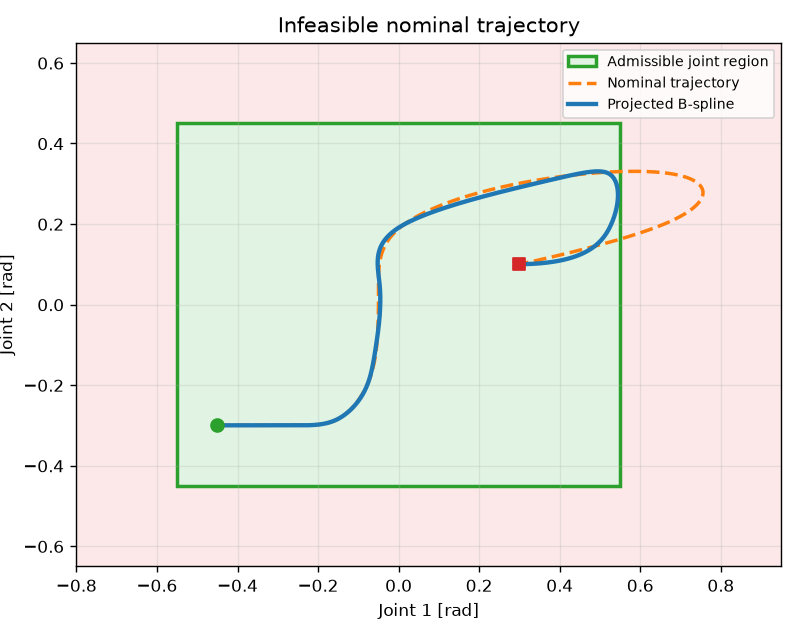
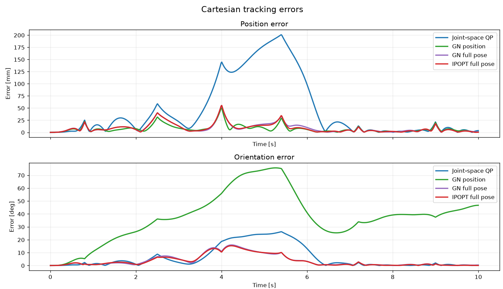
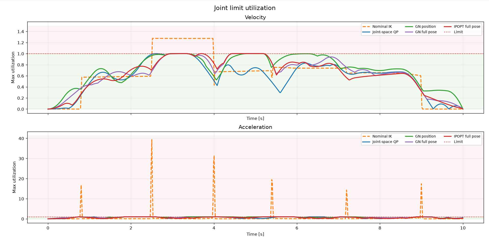
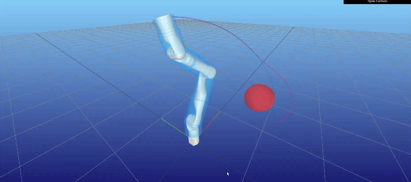
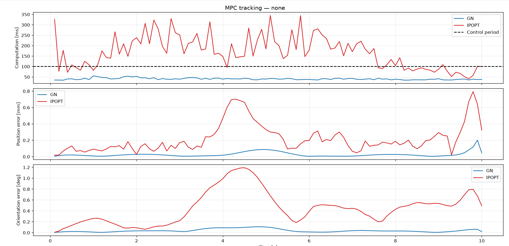
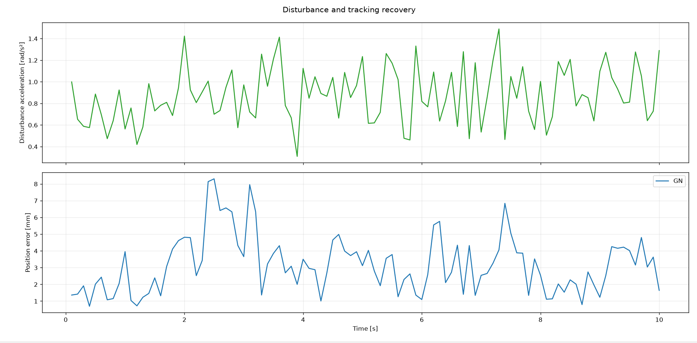
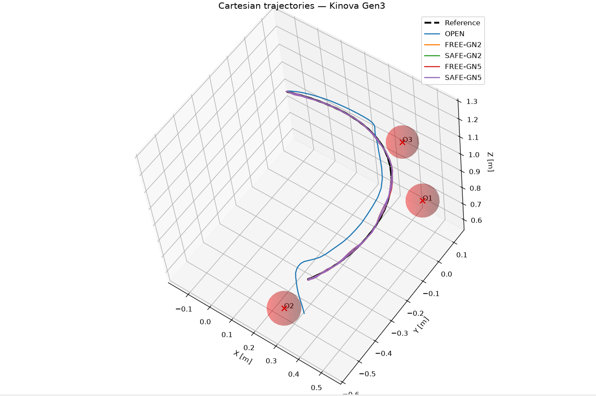
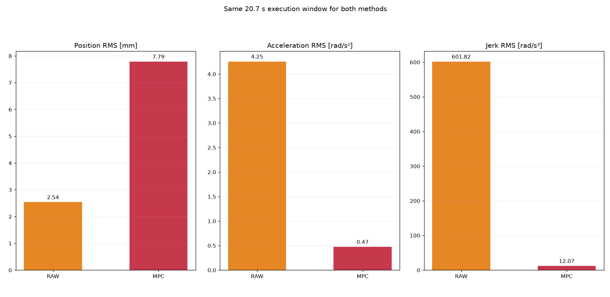
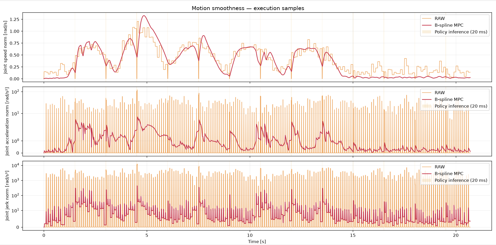

# B-Spline Trajectory Optimization for Robot Motion

A Python framework for robot trajectory generation and optimization using B-splines, with applications ranging from offline motion planning to constrained Cartesian optimization, collision avoidance, and Model Predictive Control (MPC).

## Overview

B-splines provide a flexible and compact representation of continuous trajectories, making them particularly useful for robotic motion optimization. Their mathematical properties allow trajectory smoothness, tracking objectives, and joint constraints to be incorporated into a common optimization framework.

This project explores several adjacents applications of B-spline trajectory optimization:

- **Trajectory generation and projection:** generate smooth trajectories or project existing references onto trajectories satisfying joint position, velocity, and acceleration constraints.
- **Cartesian trajectory optimization:** optimize robot motion to track desired end-effector positions and orientations using forward kinematics.
- **Collision avoidance:** incorporate geometric constraints to generate trajectories that avoid obstacles while satisfying joint limits.
- **Model Predictive Control:** repeatedly optimize trajectories over a receding horizon, accounting for the current robot state and evolving references.
- **Policy integration:** process action chunks generated by a simulated high-level policy to produce smoother, constraint-aware motion.

The framework includes quadratic programming formulations for joint-space optimization and nonlinear optimization methods based on Gauss-Newton and IPOPT for Cartesian problems.

The different approaches are illustrated through numerical examples and simulations of a **Kinova Gen3 7-DoF manipulator**, using Pinocchio for kinematics and Meshcat for visualization.

## Mathematical formulation

### B-spline trajectory representation

A joint-space trajectory is represented by a B-spline of degree $p$:

$$
q(t) = \sum_{i=0}^{n-1} B_{i,p}(t)c_i = A^{(0)}(t)c,
$$

where:

- $q(t) \in \mathbb{R}^{n_q}$ is the vector of joint positions at time $t$.
- $n_q$ is the number of robot joints.
- $p$ is the polynomial degree of the B-spline.
- $n$ is the number of control points.
- $B_{i,p}(t)$ is the $i$-th B-spline basis function of degree $p$, defined by the spline knot vector.
- $c_i \in \mathbb{R}^{n_q}$ is the $i$-th control point, containing one coefficient per joint.
- $c$ denotes the collection of all control points.
- $A^{(0)}(t)$ is the spline evaluation operator, constructed from the basis functions, which maps the control points to the joint configuration at time $t$.

The trajectory derivatives are obtained by differentiating the B-spline basis functions:

$$
\dot q(t) = A^{(1)}(t)c,
\qquad
\ddot q(t) = A^{(2)}(t)c,
$$

where $A^{(1)}(t)$ and $A^{(2)}(t)$ are the corresponding first- and second-derivative evaluation operators.

Importantly, the trajectory and its derivatives remain **linear with respect to the optimization variables $c$**. This makes it possible to formulate many trajectory optimization problems with relatively few decision variables and efficiently computable derivatives.

### Joint constraints and the convex-hull property

A key advantage of B-splines is their **convex-hull property**: every point on the trajectory lies within the convex hull of its control points. Consequently, if all control points satisfy a convex constraint, the entire trajectory satisfies it as well.

This property also applies to velocity and acceleration, since the derivatives of a B-spline are themselves B-splines, with control points obtained through linear transformations of the original coefficients.

Joint position, velocity, and acceleration limits can therefore be enforced through linear inequalities:

$$
q_{\min} \le D_0c \le q_{\max},
$$

$$
\dot q_{\min} \le D_1c \le \dot q_{\max},
$$

$$
\ddot q_{\min} \le D_2c \le \ddot q_{\max}.
$$

Here, $D_0$, $D_1$, and $D_2$ map the original coefficients to the control points of the position, velocity, and acceleration splines, respectively.

These conditions provide **continuous-time constraint satisfaction** without requiring dense temporal sampling. They are sufficient but conservative: a trajectory may satisfy the constraints even when some of its control points do not.

### Trajectory optimization

The spline coefficients can be optimized according to the application. A typical objective combines reference tracking with a smoothness penalty:

$$
\min_c \;
\sum_{k=1}^{N}
\left\|A^{(0)}(t_k)c-q_{\mathrm{ref}}(t_k)\right\|^2
+
\lambda
\int_0^T
\left\|\ddot q(t)\right\|^2\,dt.
$$

Here:

- $t_k$ are the sampling instants used to evaluate the tracking objective.
- $q_{\mathrm{ref}}(t_k)$ is the desired joint configuration at time $t_k$.
- $N$ is the number of tracking samples.
- $\lambda$ determines the relative importance of trajectory smoothness.

For joint-space tracking, the objective is quadratic in $c$, and the joint constraints are linear. The resulting problem can therefore be formulated as a quadratic program (QP).

For Cartesian tracking, robot forward kinematics introduces a nonlinear objective:

$$
\min_c \;
\sum_{k=1}^{N}
\left\|f(q(t_k))-x_{\mathrm{ref}}(t_k)\right\|^2,
$$

where $f$ maps joint configurations to end-effector poses and $x_{\mathrm{ref}}$ denotes the desired Cartesian reference. In practice, position and orientation tracking can be weighted separately.

The framework supports nonlinear optimization through Gauss-Newton and IPOPT, while retaining the same underlying B-spline trajectory representation.

### Collision avoidance

Robot-obstacle distances can also be incorporated as constraints:

$$
d_j(q(t_k)) \ge d_{\mathrm{safe}},
$$

where:

- $d_j(q)$ is the signed clearance between a robot collision primitive and an obstacle at configuration $q$.
- $d_{\mathrm{safe}}$ is the required minimum safety distance.
- $t_k$ are selected collision evaluation times.

Unlike joint position, velocity, and acceleration limits, collision avoidance generally defines a non-convex constraint in joint space. The convex-hull property cannot therefore be used directly to guarantee collision avoidance by constraining the spline control points.

Instead, collision constraints are evaluated at selected points along the trajectory and handled through nonlinear optimization.

Their satisfaction at these points does not automatically guarantee collision avoidance at every intermediate instant.

### Model Predictive Control (MPC)

The optimization framework can also be used in a receding-horizon setting through **Model Predictive Control (MPC)**.

At each control cycle, a B-spline trajectory is optimized over a finite prediction horizon, starting from the current joint position and velocity. Only the first portion of the optimized trajectory is executed before the problem is updated and solved again.

This allows the trajectory to be continuously adapted to the robot's current state, changing references, and collision constraints.

To improve computational efficiency, the implementation includes:

- **Warm starting:** the previous optimized B-spline is shifted to initialize the next optimization.
- **Feasibility projection:** warm-start control points can be projected onto the linear joint constraints using a quadratic program.
- **Limited Gauss-Newton iterations:** a fixed optimization budget can be used to reduce computation time, with feasibility checks before accepting solutions.
- **Dynamic collision activation:** collision constraints are activated when obstacles become sufficiently close to the planned motion, avoiding unnecessary collision computations when they are not relevant.

The framework supports both standard Cartesian MPC and collision-aware MPC.

The numerical experiments evaluate tracking accuracy, constraint satisfaction, robustness to disturbances, and computational performance.

## Examples and results

The following examples illustrate different applications of B-spline trajectory optimization, from simple joint-space problems to Cartesian optimization, collision-aware MPC, and policy-generated motion.

### 1. Joint-space trajectory projection

This example illustrates how B-spline optimization can transform an infeasible reference trajectory into a smooth trajectory satisfying joint constraints.

Two scenarios are available:

- **1-DoF:** a reference trajectory violates velocity and acceleration limits.
- **2-DoF:** a reference trajectory leaves the admissible joint-position region while also exhibiting dynamic constraint violations.

In both cases, a quadratic program minimizes the deviation from the reference while enforcing position, velocity, and acceleration bounds through the B-spline control points.

**Run the example:**

```bash
python -m examples.basics.trajectory_projection
```



*The nominal trajectory (orange) leaves the admissible joint region (green), while the optimized B-spline (blue) remains within its boundaries.*

The optimizer preserves the overall shape of the reference while modifying the portion that violates the joint-position limits. The optimized trajectory follows the nominal motion over most of its duration but deviates near the upper boundary to remain within the admissible region.

Thanks to the B-spline convex-hull property, joint constraints are enforced over the **entire continuous-time trajectory**, not only at the displayed sampling points.

This illustrates a fundamental trade-off: **exact reference tracking may need to be sacrificed to ensure feasibility**.

### 2. Cartesian trajectory optimization on Kinova Gen3

The framework is evaluated on a simulated **Kinova Gen3 7-DoF manipulator**, using a nominal trajectory that violates joint velocity and acceleration limits.

Four optimization methods are compared:

- **Joint-space QP:** projects the nominal joint trajectory onto the admissible set without directly optimizing Cartesian tracking.
- **Position-only Gauss-Newton:** minimizes end-effector position error without explicitly preserving orientation.
- **Full-pose Gauss-Newton:** jointly minimizes end-effector position and orientation errors.
- **Full-pose IPOPT:** solves the nonlinear trajectory optimization problem using a general-purpose solver.

All methods use the same B-spline representation and enforce joint constraints, but differ in their objectives and numerical approaches.

**Run the comparison:**

```bash
python -m examples.offline.kinova_optimization --no-animation
```

#### Cartesian tracking performance



*End-effector position and orientation errors for the different optimization methods.*

The experiments highlight the importance of choosing an optimization objective suited to the task. Joint-space projection guarantees feasibility but does not necessarily preserve the end-effector pose, while Cartesian optimization exploits the robot's kinematic redundancy to improve tracking.

| Method | Position RMS | Orientation RMS | Solve time |
|---|---:|---:|---:|
| Joint-space QP | 75.89 mm | 10.68° | 0.096 s |
| GN position-only | 10.41 mm | 42.59° | 0.907 s |
| GN full-pose | 13.06 mm | 5.85° | 0.791 s |
| IPOPT full-pose | 12.76 mm | 5.67° | 12.365 s |

The **joint-space QP** is the fastest method, but produces the largest position error. Position-only Gauss-Newton substantially improves translational tracking, at the expense of large orientation deviations.

Full-pose Gauss-Newton provides a more balanced result, achieving **13.06 mm position RMS and 5.85° orientation RMS in 0.79 s**.

IPOPT achieves slightly better tracking accuracy, but requires **12.37 s**, approximately 15.6 times longer than full-pose Gauss-Newton in this experiment.

These results illustrate the trade-off between **tracking accuracy, optimization objectives, and computational cost**.
The results highlight the importance of optimizing in the appropriate space.

The **joint-space QP** satisfies joint constraints but introduces substantial Cartesian tracking error, reaching approximately 200 mm at the most difficult point of the trajectory. This occurs because minimizing changes in joint coordinates does not necessarily preserve the end-effector pose.

By contrast, **Cartesian Gauss-Newton and IPOPT** significantly improve end-effector tracking by explicitly accounting for robot forward kinematics.

However, position-only Gauss-Newton illustrates another trade-off: although it achieves good translational accuracy, its orientation can deviate by more than 70° from the reference. Full-pose optimization avoids this behavior by including orientation tracking in the objective.

For the evaluated scenario, full-pose Gauss-Newton achieves approximately **13.1 mm RMS position error** and **5.85° RMS orientation error**, compared with **75.9 mm RMS position error** for the joint-space QP.

#### Joint constraint satisfaction



*Maximum utilization of joint velocity and acceleration limits over time. A utilization above 1 indicates a constraint violation.*

The nominal trajectory contains significant dynamic constraint violations, including velocity utilization above 1 and large acceleration peaks.

In contrast, the optimized trajectories satisfy the prescribed velocity and acceleration limits. The B-spline formulation therefore allows Cartesian tracking objectives to be optimized while maintaining continuous-time joint feasibility.

The figure also illustrates how the different methods exploit the available joint motion. Some Cartesian solutions operate close to the velocity limits to improve end-effector tracking, whereas the joint-space QP may use less of the available motion capacity at the cost of larger Cartesian errors.

#### Collision avoidance

The framework also supports geometric collision constraints during offline Cartesian optimization.

In this demonstration, the nominal trajectory intersects a spherical obstacle. The optimizer modifies the robot motion to avoid the obstacle while respecting joint limits and maintaining Cartesian tracking as closely as possible.

**Run the example:**

```bash
python -m examples.offline.kinova_collision_optimization --scenario avoidance --no-animation
```



*Collision-aware trajectory optimization on the Kinova Gen3, illustrated with a spherical obstacle.*

The optimization introduces a geometric constraint requiring a minimum signed clearance between the robot and the obstacle.

For a prescribed safety margin of **20 mm**, the experiment produces:

| Trajectory | Minimum clearance |
|---|---:|
| Nominal trajectory | −124.9 mm |
| Collision-aware Gauss-Newton | +19.8 mm |

The negative nominal clearance indicates substantial geometric intersection, while the optimized trajectory avoids contact and approaches the prescribed safety margin within numerical tolerance.

This requires a deviation from the nominal trajectory, illustrating the trade-off between Cartesian tracking accuracy and collision avoidance.

Unlike the joint constraints, collision constraints are checked at selected points along the trajectory and do not provide a general continuous-time collision-free guarantee.

For a prescribed safety margin of **20 mm**, the experiment produces:

| Method | Position RMS | Minimum clearance | Solve time | Safety |
|---|---:|---:|---:|---|
| FREE (no collision constraints) | 0.14 mm | −124.90 mm | 0.747 s | FAIL |
| Collision-aware GN | 29.32 mm | +19.79 mm | 3.069 s | PASS |

Without collision constraints, the optimizer achieves nearly perfect Cartesian tracking in approximately 0.75 s, but the resulting trajectory intersects the obstacle significantly.

With collision-aware Gauss-Newton, the optimization takes approximately 3.07 s and produces a trajectory that avoids geometric contact, reaching the prescribed 20 mm safety margin within numerical tolerance.

This illustrates a three-way trade-off between **tracking accuracy, collision avoidance, and computational cost**. Enforcing collision constraints increases the position RMS error from 0.14 mm to 29.32 mm and the solve time by approximately a factor of four.

Unlike joint constraints, collision constraints are evaluated at selected points along the trajectory and do not provide a general continuous-time collision-free guarantee.
### 3. Model Predictive Control on Kinova Gen3

The B-spline optimization framework is extended to a receding-horizon setting, where a new trajectory is computed at each control cycle from the current robot state.

The following experiments evaluate Cartesian tracking performance, robustness to external disturbances, and computational efficiency on a simulated Kinova Gen3.

#### Cartesian MPC: Gauss-Newton vs IPOPT

The first experiment considers a feasible Cartesian reference trajectory over **10 seconds**, using a **100 ms control period** and a **1.5 s prediction horizon**.

Two nonlinear optimization approaches are compared:

- **Gauss-Newton (GN):** performs five iterations per control cycle, using the previous solution as a warm start.
- **IPOPT:** solves the nonlinear optimization problem with convergence-based stopping criteria.

**Run the comparison:**

```bash
python -m examples.mpc.kinova_mpc_tracking --solver both --mode none --no-animation --show-plots
```



*Comparison of per-cycle computation times, Cartesian position errors, and orientation errors for Gauss-Newton and IPOPT. The dashed line indicates the 100 ms control period.*

| Metric | GN-5 | IPOPT |
|---|---:|---:|
| Mean computation time | 40.44 ms | 169.16 ms |
| P95 computation time | 49.86 ms | 314.77 ms |
| Maximum computation time | 54.95 ms | 344.47 ms |
| Position RMS | 0.039 mm | 0.278 mm |
| Orientation RMS | 0.047° | 0.539° |
| Completed cycles | 100/100 | 100/100 |
| Cycles within 100 ms | 100% | 25% |

Both methods achieve accurate Cartesian tracking in the absence of disturbances, with sub-millimeter position errors.

However, the computation-time difference is substantial. Gauss-Newton remains below the 100 ms control period for every cycle, with a mean computation time of approximately **40 ms**. IPOPT requires approximately **169 ms on average**, exceeding the control period in 75% of cycles.

The tracking errors also favor Gauss-Newton in this experiment. Despite running only five iterations per cycle, it achieves lower position and orientation errors than IPOPT.

These results highlight the benefit of warm starting and a limited iteration budget for repeated trajectory optimization. In a receding-horizon setting, obtaining a sufficiently accurate and feasible solution quickly can be more useful than solving each nonlinear optimization problem to convergence.

The comparison is specific to the evaluated configuration and does not imply that Gauss-Newton is universally more accurate than IPOPT.

#### Robustness to continuous disturbances

The second experiment evaluates the controller under external disturbances.

Random Gaussian acceleration disturbances, with a standard deviation of **0.35 rad/s²**, are applied to the robot joints throughout the trajectory. At each cycle, the MPC updates its trajectory using the current simulated state, rather than continuing to execute the original plan unchanged.

The Gauss-Newton solver is again limited to five iterations per cycle.

**Run the experiment:**

```bash
python -m examples.mpc.kinova_mpc_tracking --solver gn --mode gaussian --no-animation --show-plots
```



*Magnitude of the applied acceleration disturbance and resulting end-effector position error over time.*

The upper plot illustrates the continuous and irregular nature of the applied disturbances. Unlike a single impulse or a temporary bias, these perturbations persist throughout the simulation.

The lower plot shows that the MPC maintains relatively small Cartesian tracking errors despite these disturbances. The position error fluctuates as the robot is repeatedly perturbed and the MPC updates its trajectory, but remains below approximately **8.3 mm** throughout the experiment.

The measured performance is:

| Metric | GN-5 |
|---|---:|
| Mean computation time | 43.92 ms |
| P95 computation time | 61.95 ms |
| Maximum computation time | 95.75 ms |
| Position RMS | 3.59 mm |
| Maximum position error | 8.30 mm |
| Orientation RMS | 0.803° |
| Maximum linear constraint violation | 0 |
| Completed cycles | 100/100 |
| Cycles within 100 ms | 100% |

Compared with the undisturbed experiment, the position RMS increases from **0.039 mm to 3.59 mm**, as expected when external disturbances continuously affect the robot.

Nevertheless, the MPC completes all 100 control cycles, maintains the planned trajectory constraints, and remains within the 100 ms computation budget for every cycle.

The mean computation time increases only moderately, from **40.44 ms to 43.92 ms**, although the maximum reaches approximately **95.75 ms**.

These results demonstrate the ability of the receding-horizon optimizer to maintain accurate tracking under persistent disturbances, while operating within the specified computational budget in this simulation.

Other disturbance scenarios, including a single acceleration kick and a temporary constant bias, are also available in the example.

**Timing and simulation limitations:** reported computation times include warm-start correction and MPC optimization, but not the complete robot control loop. The simulation applies external disturbances after planning, so executed accelerations may differ from the planned spline constraints. These results do not establish hard real-time performance on physical hardware.

#### Collision-aware MPC in a cluttered environment

The final MPC experiment evaluates collision avoidance in a cluttered environment containing **three spherical obstacles**.

The nominal Cartesian reference is feasible and collision-free, but passes close to the obstacles. Gaussian acceleration disturbances are introduced during execution, potentially causing deviations that violate the required safety margin.

Three approaches are compared:

- **OPEN:** direct execution of the nominal reference without MPC correction.
- **FREE:** Cartesian MPC with joint constraints but without collision avoidance.
- **SAFE:** Cartesian MPC with additional collision constraints and dynamic obstacle activation.

Both MPC approaches are tested with Gauss-Newton iteration budgets of two and five iterations per cycle. The experiment uses a **100 ms control period**, a **1.5 s prediction horizon**, and a **20 mm collision safety margin**.

**Run the benchmark:**

```bash
python -m examples.mpc.kinova_mpc_cluttered_tracking --no-animation --show-plots
```

<!-- Replace the filename with the exported 3D trajectory figure. -->


*Three-dimensional visualization of the Kinova Gen3 trajectory and surrounding obstacles in the cluttered MPC benchmark.*

The results are summarized below:

| Method | Completed cycles | Position RMS | Min. clearance | Mean compute | P95 compute |
|---|---:|---:|---:|---:|---:|
| OPEN | 55/100 | 57.25 mm | −41.07 mm | — | — |
| FREE-GN2 | 100/100 | 3.59 mm | 18.63 mm | 18.03 ms | 22.65 ms |
| SAFE-GN2 | 27/100 | 3.78 mm | 22.3 mm | 159.41 ms | 221.28 ms |
| FREE-GN5 | 100/100 | 3.59 mm | 18.54 mm | 42.52 ms | 51.90 ms |
| SAFE-GN5 | 100/100 | 3.57 mm | 20.32 mm | 383.92 ms | 740.24 ms |

*Clearance and tracking statistics are evaluated over the successfully executed cycles of each method. Computation times include warm-start handling and MPC optimization.*

**Tracking and feasibility.** Without MPC correction, OPEN accumulates substantial tracking errors and eventually violates joint or velocity limits, terminating after 55 cycles. Both FREE configurations complete the full trajectory with approximately 3.59 mm RMS position error, illustrating the ability of the MPC to compensate for disturbances while maintaining joint feasibility.

**Collision avoidance.** FREE-GN5 reaches a minimum clearance of 18.54 mm, falling below the prescribed 20 mm margin for one executed state. SAFE-GN5 maintains a minimum evaluated clearance of 20.32 mm, without observed safety-margin violations. Both trajectories remain free of geometric intersection in this experiment, so the difference concerns **preservation of the safety margin**, rather than avoidance of an actual collision by FREE.

**Computational cost.** The additional collision constraints substantially increase optimization time. SAFE-GN5 requires approximately **384 ms per cycle**, compared with **42.5 ms for FREE-GN5**, making it roughly nine times slower. SAFE-GN5 therefore exceeds the 100 ms control period and is not suitable for real-time execution under the tested configuration.

Solver robustness. With only two Gauss-Newton iterations, SAFE-GN2 fails at cycle 28 because the candidate solution does not satisfy the linear acceleration constraints within the acceptance tolerance. This illustrates how collision-aware optimization can become more difficult under restrictive iteration budgets.

Overall, the benchmark demonstrates that collision-aware B-spline MPC can maintain a prescribed clearance margin under disturbances, but at a significant computational cost. Further improvements would be needed to make the tested collision-aware configuration compatible with the control period.

Collision constraints are evaluated at discrete points, so these observations do not constitute a continuous-time collision-avoidance guarantee.

### 4. Policy-generated motion smoothing

The final example explores how B-spline MPC can be integrated with a simulated high-level robot policy that generates successive *action chunks* rather than a complete trajectory.

The simulated policy periodically produces short Cartesian motion segments containing noise, bias, and tremor. These segments are converted into joint-space references and processed by the B-spline optimizer.

Two execution approaches are compared:

- **RAW:** directly executes the joint-space commands obtained from the simulated policy, holding commands during inference delays.
- **B-spline MPC:** continuously reoptimizes a smooth trajectory to track the policy reference while enforcing joint position, velocity, and acceleration constraints.

The experiment uses a **20.7 s execution window**, **14 policy chunks**, a **100 ms MPC period**, and **10 ms execution sampling**. Policy inference latency is simulated at **20 ms**, with position noise of 1.5 mm, bias of 0.5 mm, and tremor amplitude of 1.0 mm.

**Run the example:**

```bash
python -m examples.policy.kinova_policy_mpc --show-plots
```

#### Tracking accuracy and motion smoothness



*Comparison of Cartesian position RMS, joint acceleration RMS, and joint jerk RMS over the same 20.7 s execution window.*

| Metric | RAW | B-spline MPC |
|---|---:|---:|
| Position RMS | 2.54 mm | 7.79 mm |
| Joint acceleration RMS | 4.25 rad/s² | 0.47 rad/s² |
| Joint jerk RMS | 601.82 rad/s³ | 12.07 rad/s³ |
| Maximum acceleration limit violation | 89.9 rad/s² | < 2 × 10⁻¹¹ rad/s² |

The RAW trajectory achieves better Cartesian tracking accuracy but exhibits substantial acceleration and jerk, caused by noise and discontinuities in the policy-generated commands.

B-spline MPC significantly improves motion regularity, reducing **acceleration RMS by approximately 89%** and **jerk RMS by approximately 98%**.

This improvement comes at the cost of increased tracking error, from 2.54 mm to 7.79 mm RMS. Rather than following every fluctuation of the noisy reference, the optimizer prioritizes smoother motion and joint feasibility.

#### Motion continuity across action chunks



*Comparison of joint speed, acceleration, and jerk during execution. Shaded regions indicate simulated policy inference periods.*

The time-domain plots provide a more detailed view of the smoothing effect.

The RAW commands exhibit irregular velocity profiles and sharp acceleration and jerk peaks, particularly around successive policy updates. These discontinuities result from directly executing noisy joint commands and temporarily holding them during inference.

In contrast, the B-spline MPC generates much smoother velocity profiles and substantially reduces the high-frequency variations in acceleration and jerk. The improvement remains visible across successive action chunks and during inference delays.

This illustrates the role of the optimizer as a **motion-conditioning layer** between a high-level policy and robot execution.

#### Computational performance

The MPC completes **207 optimization cycles** over the full execution window, with the following performance:

| Metric | B-spline MPC |
|---|---:|
| Mean computation time | 17.99 ms |
| P95 computation time | 24.65 ms |
| Missed 100 ms deadlines | 0 |
| Projected warm-start fallbacks | 4 |

The MPC remains within the 100 ms computation budget for every cycle in this experiment, demonstrating that the smoothing and constraint-enforcement operations can be performed online in the tested configuration.

#### Interpretation and limitations

This example demonstrates how B-spline optimization can improve the smoothness and dynamic feasibility of trajectories generated by a high-level policy, while introducing a moderate tracking penalty.

The high-level policy is **simulated**, rather than a trained imitation-learning or reinforcement-learning model. Both approaches receive identical action chunks, and the 20 ms inference latency is simulated rather than measured.

The reported acceleration and jerk metrics are obtained from finite differences of commanded joint positions. RAW inverse kinematics is precomputed and excluded from online computation timings.

Finally, the results should not be interpreted as proof that smoothing always improves task performance. A learned policy operating in closed loop and generating more consistent action chunks might require substantially less correction.

The experiment instead illustrates a practical application of the framework: **converting noisy, chunked motion references into smoother, constraint-aware robot trajectories within a limited computation budget**.

## Installation

The project requires **Python 3.10 or later**. A Conda environment is recommended to manage the robotics and numerical optimization dependencies.

### 1. Clone the repository

```bash
git clone https://github.com/solalwarg123/Trajectory_Spline_Optimisation.git
```

### 2. Create a Conda environment

Create and activate a dedicated environment:

```bash
conda create -n bspline python=3.11 -y
conda activate bspline
```

### 3. Install Pinocchio

Install Pinocchio through conda-forge:

```bash
conda install -c conda-forge pinocchio -y
```

### 4. Install the project and dependencies

Install the project in editable mode, including robotics, visualization, and testing dependencies:

```bash
python -m pip install -e ".[robotics,dev]"
```

This installs the core optimization library together with its required dependencies, including NumPy, SciPy, OSQP, Meshcat, Matplotlib, and pytest.

### 5. IPOPT support

To run examples using IPOPT, install CyIpopt through conda-forge:

```bash
conda install -c conda-forge cyipopt -y
```

### 6. Verify the installation

```bash
python -m pytest -q
python -m examples.basics.trajectory_projection
```

